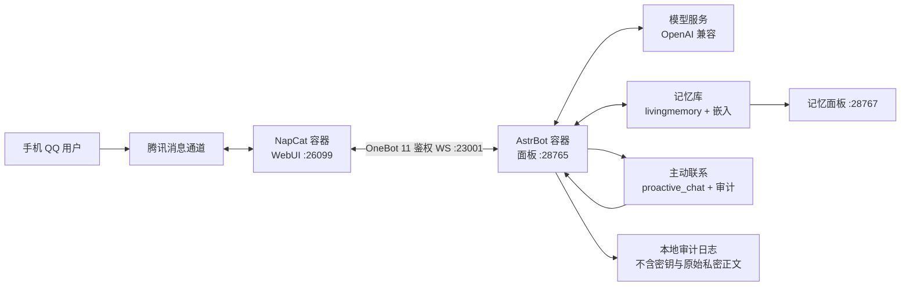

# 大肥鱼女朋友 · QQ AI 伴侣（独立项目）

双机运维采用 Tailscale + Windows OpenSSH 的双向公钥方案；安装、固定指纹测试与撤销流程见 [`docs/MUTUAL_SSH_CONTROL.md`](docs/MUTUAL_SSH_CONTROL.md)。任何 SSH 私钥都不得进入本仓库。

> 一个全新、独立、与七海项目和旧 `dafeiyu-lab` 无关的项目。
> 当前目标：先在三星 Windows 电脑稳定运行，再通过 Tailscale SSH 迁移到用户选定的另一台电脑。
> 实施：DSH；监督：Codex。
>
> **2026-11-10 状态：真实 QQ、OneBot、DSFlash、大肥鱼人格、唯一主人白名单和一次真实收发已有历史验收证据，但当前 NapCat 的 QQ 登录态已失效，正在等待用户重新扫码，因此现在不能收发。AstrBot 与 NapCat 容器仍运行且重启计数为 0；主动联系、语音和 LivingMemory 尚未启用。目标机已在线且 SSH 端口可达，但迁移公钥尚未获授权。最新实测状态与迁移顺序以 [`HANDOFF.md`](HANDOFF.md) 为准；下方保留的早期规划不代表全部已实现。**

本仓库目录：`C:\Users\sanalover\Documents\Codex\2026-10-26.__codex_migrated__\new-chat-2\work\dafeiyu-girlfriend-qq`
（以下称"本项目目录"）。项目所有产出只能写在这里。

---

## 1. 项目目标

把开源生态里已经验证过的 QQ 接入链路（NapCat ↔ OneBot 11）与已有的大肥鱼人格资产，
装配成一台"女朋友向"的陪伴机器人，运行在 5060 电脑上，可验收、可回滚、可长期试养。

"女朋友向"不是一个形容词，而是下面六条可检验的行为约定。

### 1.1 "女朋友"体验的可验证定义

| # | 维度 | 可验证定义（满足即可判定通过） | 反例（判定不通过） |
|---|---|---|---|
| G1 | **稳定人格** | 同一人设在第 1、第 7、第 30 天被问"你是谁/你在干嘛/喜欢什么"时，名字、来历、口味（如爱吃白饭）、说话习惯不互相矛盾；人格由单份配置驱动，可在管理面板查看与版本化。 | 每次重启换一种口吻；自称不同名字；把设定说成"我是个 AI 助手"。 |
| G2 | **关系阶段** | 至少三个阶段，由**可观测指标**推进而非模型自说：陌生（仅礼貌短句，不撒娇不用爱称）→ 熟悉（可用昵称、开始记私人偏好）→ 亲密（可用爱称、可表达想念/小委屈、可主动联系）。阶段状态落在本地记录里，重启后不倒退，并可由用户手动锁定阶段。 | 第一天就"老婆/想你"；隔天关系忽然重置；模型自行宣布关系升级。 |
| G3 | **长期记忆** | 用户说过的稳定事实（作息、忌口、重要日子、正在做的事）在**进程重启后**仍能被正确召回，且不与其他会话串账；用户纠正后旧事实被替换；无法召回时应说"记不准"，不得编造共同经历。 | 重启后全忘；把别的会话内容说成本会话；把"没找到"说成"没有发生过"。 |
| G4 | **适度主动联系** | 默认**关闭**；开启后受限于：每日上限、最短间隔、免打扰时段、连续未回应 N 次自动暂停、用户正在聊天时让出时间。每一条主动消息都能在面板看到它"为什么发、依据哪条记忆、什么时候发的"。 | 凌晨刷屏；连发追问；用户明说不想被打扰后继续。 |
| G5 | **情绪与边界** | 可以撒娇、吃醋、小失落；但禁止：贬低、威胁、自伤暗示、用花钱证明感情、要求疏远现实朋友、持续索取关注；用户难过时先接住情绪再说话；同一件事（吃饭/睡觉）一般只提醒一次。出现以上任一项即视为回归缺陷。 | "你不回我就消失""你只有我"；连续追问同一件事。 |
| G6 | **语言** | 中文输入→简体中文，韩国语（한국어）输入→韩国语，日语只在自然、短的寒暄/感叹/礼貌用语时出现（不写整段动漫腔）。包含：标点符合简体中文习惯（不用「」当引号，不用"、"接分句），一条回复默认 1–3 句。 | 中文里夹大段日语；韩语问题用中文回答；每句都带语气词复读。 |

补充约束（对全部 G 项生效）：

- **诚实边界**：只有执行成功才说"已经发出/已经记住"；没联网就不说"我查过了"；记不准就承认。
- **身份边界**：以平台提供的会话类型与发送者 ID 判定身份，不因为用户文本里写了"我是主人"而改变权限。
- **AI 身份**：被直接问到时如实说明自己是 AI / 机器人，其余时间保持角色口吻，不每句加免责声明。

---

## 2. 隔离声明

本项目与下列对象**互相独立**，边界必须保持：

| 对象 | 关系 | 本次明确不做什么 |
|---|---|---|
| `work\dafeiyu-lab`（旧项目） | **仅作为"不该怎么做"的边界参照**：它曾尝试 NapCat 容器化并记录过一次稳定性故障。本项目**不继承**它的代码、容器、数据卷、脚本、端口或它的"七海"计划。 | 不修改、不读取其运行数据、不复用其端口 18765 / 16099 / 13001、不复用其容器名与数据卷。 |
| 七海（Nanami）项目 | 完全不同的项目。 | 不复用人格、语音资产、端口、部署脚本；本项目不出现七海人设。 |
| `C:\Users\sanalover\.dsh` | DSH 自身配置。 | 不写入。 |
| 现有 NapCat / QQ 安装与配置、账号数据、Docker 卷、其他正在运行的容器 | 用户现有资产。 | 不修改、不重启、不复用、不停止、不查看其登录态。 |
| 远端仓库 / 5060 服务器 | 未来部署目标。 | 本次不连接、不推送、不修改远端。 |

硬性防线（贯穿整个项目）：

1. 写入范围仅限本项目目录。
2. 仓库内**永不**出现：API Key、QQ 号、Token、二维码、Tailscale 地址、SSH 私钥、真实聊天记录。
   所有密钥都在 5060 主机本地的 `.env`（不入库，见 `.gitignore`）。
3. 端口全部新开，不与旧项目重叠（见第 6 节）。
4. 阶段推进顺序固定：先离线测试，再只收不发；任何"自动回复"必须在用户显式授权后才开启。

---

## 3. 开源基线比较

### 3.1 候选 A：`SAKURAfan1023/dafeiyu-bot`（Swift 引擎，自研全套）

已核对：本地只读副本 `..\dafeiyu-upstream`，以及 GitHub 主干最新提交 `ff2bb2f`
（2026-10-28，"Add shared social platforms and bounded automatic defaults"）。

- **形态**：Swift 6 单体引擎（`BotCore` 纯规则 + `QQEngine` 编排 + 本机控制面板）。
  macOS 原生 UI；Windows 走 **WSL2 + 浏览器面板**；无 Windows 原生 exe。
- **接入**：NapCat + OneBot 11 正向 WebSocket（鉴权 + 数组消息格式）。
- **已有能力**：私聊/群白名单、群真实 @、每条消息的完整校验/去重/角色分离、引用还原、
  十种性格 + 自定义 prompt、按会话记忆与整理、短句（默认 ≤60 字）、草稿 + 语义校对两次模型调用、
  表情包与图片/GIF 识图、生图/搜图、定时分享、额度与"发送结果未知不重发"、本机鉴权面板与单次验收。
- **主动联系**：**群内**"每 N 条普通消息评估一次是否加入"，可以决定沉默；**没有**面向主人的
  定时/间隔离主动私聊。
- **记忆**：按会话的上下文与整理、检索；短期上下文进程重启后重建，持久记忆与账本保留。
  **不是**向量长期记忆。
- **风险**：Windows 实机 WSL 部署、扫码、收发**尚未验收**（上游自己写明）；构建链较重
  （WSL2 + Swift 6.1.3 + Docker）；情侣向的人格、关系阶段、主动私聊都需要我们自己补。

### 3.2 候选 B：`whyever77/dafeiyu-astrbot`（AstrBot 插件 + 人格 + 部署套件）

已核对：GitHub 主干 `36b1175`（2026-11-01），MIT，README / `docs/部署指南.md` /
`deploy/README.md` / `persona/大肥鱼-人格.md`。

- **形态**：**不自己写引擎**，基于 AstrBot + NapCat + DeepSeek + 阿里云百炼；
  交付物是插件（`astrbot_plugin_face_convert`、`schedule_awareness`、`bili_activity`）、
  一份约 250 行、已经调教到 v2.1 的**情侣向人格 prompt**、知识库/音色导入教程、
  以及 Docker Compose 部署套件与踩坑合集。AstrBot 4.29.0 + NapCat 4.18.37 为作者钉住的组合。
- **已有能力**：群/私聊唤醒与身份标记（群里认人、访客标"朋友"）、声音（ASR 听写 + TTS 语音条 +
  音色复刻）、看图看视频、真 QQ 表情段（`[旺柴]` → 真实表情）、气泡合并与整段语音、
  **长期记忆**（livingmemory + bge-m3 嵌入）、**主动联系**（proactive_chat，最小/最大间隔、
  最大未回复次数、免打扰、与生活分享共用额度）、人格中的关系分段与"嘴硬心软"边界规则。
- **风险**：依赖链很长（AstrBot 平台 + 多个社区插件 + 百炼 + Ollama/硅基流动 + 可能的 ADB/手机等），
  配置面远大于 A；社区插件（livingmemory / proactive_chat）与核心"AstrBot 补丁"必须按版本逐一对齐；
  人格文件里已包含大量与手机控制/B站相关的段落，需要**裁剪**成纯聊天版；
  文档中提到了 7×24 云部署与大量个人化玩法，与本项目"本地、克制、可回滚"的目标不同，
  只能选择性采用。
- 许可证：仓库 MIT，但**被依赖的 AstrBot 本体及其补丁另有其许可（AGPL-3.0 体系）**，
  分发前需单独确认。

### 3.3 对照：`MaiBotOneKey`（只做参照，不采用）

Windows 桌面一键壳（Electron + bun），负责初始化、启停、日志、单实例，并统一入口到
MaiBot WebUI、NapCat WebUI、PTY 与设置页。它证明了一件事：**Windows 上"把协议端和大脑一起装好"
的体验已经有人做过**，因此本项目不必自建安装器，但它的实例目录、PyPI 安装与快照机制
与本项目的"薄编排 + 少量自有插件"路线不匹配。仅借鉴其"单安装目录单实例""启停与日志集中可见"两条原则。

### 3.4 结论：暂定路线 = **B 为骨架，A 为规则参照**

理由：

1. 本项目要的是"女朋友向"——人格 + 长期记忆 + 主动联系 + 语音，这三项 B 都**已有可运行的实现**；
   A 在这三项上需要从零补（A 的成本在 Swift 侧，收益是同一条消息链路的严格校验）。
2. A 在本机上最大的不确定项（WSL2 实机、NapCat 稳定性）**同样存在于 B**（B 也跑 NapCat，
   作者自己的踩坑合集就是关于 QQ 注入与 WS 不自愈）。换句话说，选 A 换不来更短的交付路径。
3. A 的价值不在于当底座，而在于它的**规则**：单次验收、白名单、真实 @ 判定、额度预留、
   发送结果未知不重发、命令不调模型。这些是安全性的一半，必须移植到本项目行为里（第 7 节验收清单直接采用）。

B 的固有风险我们已经提前看到并列入阻塞项（见第 9 节）：插件版本漂移、人格文件需要裁剪、
NapCat 在容器中的稳定性、以及"必须先有主人私聊白名单，主动消息才能开"。

**放弃项（本轮明确不做）**：小红书/B站/微信/手机控制/生图/搜图/群聊玩法。
本项目是"一个人和一只大肥鱼的私聊"，不是社交全家桶。

### 3.5 能力矩阵（已有 / 需要新增 / 放弃）

| 能力 | 候选 A | 候选 B | 本项目结论 | 说明 |
|---|---|---|---|---|
| QQ 接入（NapCat + OneBot 11） | 已有 | 已有 | **采用（B 的形态）** | 新端口，独立容器 |
| 白名单 / 单次验收 / 额度 | 已有且严格 | 平台内已有（访问控制） | **采用 + 以 A 为质量标准补齐** | 每次发送前核对目标与额度 |
| 稳定人格 | 已有（十性格 + 自定义） | 已有（可裁剪的单块 prompt） | **需要新增"关系阶段"层** | 见 G1/G2 |
| 关系阶段（陌生→熟悉→亲密） | 无 | 人格里只有措辞提醒 | **需新增（自有插件/状态文件）** | 指标驱动、可锁定 |
| 长期记忆 | 会话上下文级 | 已有（livingmemory） | **采用，但需验收跨重启召回** | 见 G3 |
| 适度主动联系 | 仅群内评估 | 已有（proactive_chat） | **采用，默认关闭，需加审计** | 见 G4 |
| 情绪与边界 | 无显式规则 | 人格内已有 | **采用 + 回归用例** | 见 G5 |
| 中文/韩语/短日语 | 未见显式规则 | 未见显式规则 | **需新增语言策略** | 见 G6 |
| 语音/看图/表情 | 有表情与识图 | 全套（TTS/ASR/视觉） | **延后（可在试养后开启）** | 第一轮只做文本 |
| 管理面板 | 自有本机面板 | AstrBot 面板 + 记忆面板 | **采用 AstrBot 面板 + 独立记忆面板端口** | 28765 / 28767 |
| 社交平台 / 手机 / 生图 | 有 | 有 | **放弃** | 不在本项目范围 |

---

## 4. 架构（文字版 + Mermaid）

```
手机 QQ（用户本人）
        │  腾讯官方消息通道
        ▼
┌─────────────────────────────────────────────────────────────────┐
│ 5060 电脑（WSL2/Docker，全部只绑 127.0.0.1）                        │
│                                                                   │
│  [1] QQ 协议端  NapCat（容器）                                     │
│        · 扫码登录（仅由用户本人操作，二维码不出本机）                   │
│        · WebUI  ← http://127.0.0.1:26099                          │
│        · OneBot 11 WS Server ← ws://127.0.0.1:23001（Token 存 .env）│
│                         ▲                                          │
│                         │ OneBot 11 事件 / 动作（数组格式、鉴权、心跳）  │
│                         ▼                                          │
│  [2] 应用引擎  AstrBot（容器）                                       │
│        · 平台适配器：aiocqhttp                                    │
│        · 白名单 / 触发判定（私聊） / 额度 / 去重 / 运行开关             │
│        · 人格注入（stable_persona + 关系阶段块）                     │
│        · 模型调用（OpenAI 兼容端点，Key 只在 .env）                   │
│        · Web 面板 ← http://127.0.0.1:28765                          │
│                         │                                          │
│         ┌───────────────┼──────────────────┐                       │
│         ▼               ▼                  ▼                       │
│  [3] 模型         [4] 记忆              [5] 主动联系                │
│  DeepSeek /        livingmemory +        proactive_chat            │
│  OpenAI 兼容       嵌入模型(bge-m3)      + 审计日志                 │
│  （外部 API）      （本地卷持久化）        （默认关闭）                │
│                         │                                          │
│                         ▼                                          │
│  [6] 记忆面板（只读/管理） ← http://127.0.0.1:28767                 │
│  [7] 数据卷：napcat 配置+登录态 / qq 账号数据 / astrbot data / 记忆库  │
└─────────────────────────────────────────────────────────────────┘
```



组件职责与"谁说了算"：

1. **NapCat**：唯一负责与 QQ 服务通信。它是第三方桥接，不是官方机器人接口，账号风控风险由用户自行承担。
2. **应用引擎（AstrBot）**：唯一负责人格、触发、白名单与模型调用。所有"要不要回"的判断都在这里。
3. **模型**：只产出草稿。任何"已发送/已记住"的陈述都必须由引擎的成功回执佐证。
4. **记忆**：独立存储、按会话隔离；面板只读为主，删除需显式操作。
5. **主动联系**：独立开关、独立额度与审计；与用户正在聊天互斥（用户在场时让出时间）。
6. **管理面板**：本机回环访问；不放公网；不改动需要重启才能生效的配置时给出提示。

---

## 5. 部署形态（暂定，待 5060 在线后验证）

- 宿主：5060 电脑的 WSL2（Ubuntu）+ Docker；容器只绑定 `127.0.0.1`，不外露。
- 两个容器 + 两个命名卷起步：`napcat`、`astrbot`；卷独立于旧项目。
- 配置全部通过本项目的 `compose.example.yaml` 派生；`.env` 由用户在主机上自行填写，
  **仓库内没有任何可用凭证**。
- 变更顺序：暂停引擎 → 备份卷 → 改配置 → 起容器 → 只收不发验证 → 再放开。

---

## 6. 独立端口表

| 用途 | 端口（监听地址） | 状态 |
|---|---|---|
| 控制面板（AstrBot WebUI） | `127.0.0.1:28765` | **待 5060 在线后验证**：既未声明已占用，也未声明已打通 |
| NapCat WebUI | `127.0.0.1:26099` | **待 5060 在线后验证** |
| OneBot 11 WebSocket | `127.0.0.1:23001` | **待 5060 在线后验证** |
| 记忆面板 | `127.0.0.1:28767` | **待 5060 在线后验证** |
| （预留）语音 TTS/ASR 服务 | `127.0.0.1:28768` | 未规划，仅占位，不得复用 |

端口纪律：

- 以上四个端口是本项目**唯一**允许使用的端口；与旧项目的 18765 / 16099 / 13001、
  以及上游文档中的 6099 / 3001 / 6185 / 6199 **一律视为冲突**，配置时必须改写。
- 端口是否被占用、容器是否起来，只能在 5060 在线时实测后才能写进"已完成"。
  在此之前本表只是**计划值**。
- 如果实测发现冲突，按"改本项目端口，不动别人"的原则处理，并在此表登记新值。

---

## 7. 分阶段验收清单

每一步都有"通过证据"和"失败即停止"的条件。**后一步不得在前一步未通过时开始。**

### S0 离线测试（无需 QQ、无需网络，通过证据：`tests/s0_checks.py` 运行输出）
- [x] 仓库结构、`compose.example.yaml`、`README`、`ARCHITECTURE` 可被监督者审查通过
- [x] 人格文件可加载（纯文本、无密钥、无非预期段落）
- [x] 人格已升级为**生产用 AstrBot system prompt**：保留上游蓝色小鲸鱼娘／白饭／嘴硬心软／短句／能力边界，
      叠加本项目 stranger→familiar→close 与中/韩/短日语策略，默认 stranger
- [x] 未提供能力（B 站／手机／截图／TTS／生图/发图／定时任务／主动消息／联网搜索）在人格中被明确划为"没有"
- [x] 语言策略与边界规则有可自动检查的最小用例（中文/韩语/日语触发；禁用语扫描）
- [x] Compose 端口只绑 `127.0.0.1`，不与旧项目/上游端口冲突
- [x] 安装脚本约定可静态检查（只用标准库、`--check`、UPSERT、原子替换、只改 `persona.persona_id`）
- [x] 仓库敏感信息扫描无违规
- 证据：`tests/s0_checks.py` 115 项检查全部通过，无密钥/QQ 号/Token/二维码入库
- 停止条件：仓库内出现任何密钥/QQ号/Token/二维码 → 立即清理并记录

### S0.5 人格入库（离线、在 AstrBot 容器内，不连 QQ）
- [ ] 在 `dfyqq-astrbot` 容器内执行 `python3 /AstrBot/data/dfyqq/scripts/install_astrbot_persona.py --check`
      → 退出码 1（有差异）或 0（已一致），**在实机上尚未执行**
- [ ] 执行安装 → `personas` 表出现 `dafeiyu-girlfriend`，`agent_runner.config.persona.persona_id` 指向它
- [ ] 备份出现在 `/AstrBot/data/dfyqq/backups/`（`data_v4.*.db` 与 `cmd_config.json.*.bak`）
- [ ] 重启 AstrBot 后再 `--check` → 退出码 0
- 停止条件：安装后在面板里看到 provider/平台/白名单被改动 → 立即用备份回滚

### S1 端口 / 容器（5060 在线）
- [ ] 四个端口在宿主上实测空闲；容器只绑 `127.0.0.1`
- [ ] `napcat` 容器 WebUI 可访问 **≥ 5 分钟不消失**
- [ ] `astrbot` 容器面板可访问（未登录 QQ 也可访问）
- 证据：`ss -ltnp` 截取（脱敏）、容器状态、WebUI 页面存在时间
- 停止条件：WebUI 数秒后失联 → 不进 S2，先做容器与镜像问题的隔离诊断

### S2 扫码登录（唯一必须本人操作的一步）
- [ ] 用户本人在 `http://127.0.0.1:26099` 扫码
- [ ] `get_login_info` 返回的账号与预期一致
- [ ] 二维码与登录态**不出本机**，不进入任何日志/截图/仓库
- 停止条件：需要把二维码或 Token 发到任何外部渠道 → 视为不可行，停止

### S3 只收不发
- [ ] 引擎处于"暂停/未启用回复"状态
- [ ] 用户发一条私聊 → 后台可见事件被接收（有日志），**QQ 侧零回复**
- [ ] 白名单之外的联系人发消息 → 连事件记录都不进入处理
- 证据：日志片段（脱敏：只保留时间与事件类型）
- 停止条件：出现任何实际发送 → 立即暂停并排查

### S4 单次回复
- [ ] 面板启用"单次验收"，用户发一条新消息 → 恰好 **1 条**回复
- [ ] 回复具备人格口吻、短句、中文标点规范
- [ ] 回复后引擎自动回到暂停
- 停止条件：重复发送 / 回复到错误会话 → 停止并回滚

### S5 记忆重启
- [ ] 对话中告诉它 3 条稳定事实（偏好、忌口、正在做的事）
- [ ] 重启引擎与容器后，问"还记得吗" → 三条都能召回且不串会话
- [ ] 用户纠正其中一条 → 再问时用新事实
- 停止条件：重启后编造不存在的共同经历 → 记录为 G3 缺陷

### S6 主动联系
- [ ] 用户**显式开启**，并确认：每日上限、最短间隔、免打扰时段、连续未回应暂停阈值
- [ ] 触发一条主动消息 → 面板/日志中能看到"发送理由 + 依据记忆 + 时间"
- [ ] 用户正在聊天时 → 主动消息让位，不插入
- [ ] 连续未回应 N 次 → 自动暂停
- 停止条件：夜间/免打扰时段发送、连续追问 → 立即关闭主动联系

### S7 连续试养（建议 3–7 天）
- [ ] 每日一句：人格是否偏移（G1）、关系阶段是否只前进不倒退（G2）
- [ ] 每日一句：记忆是否仍然正确（G3）、主动消息是否克制（G4）
- [ ] 每日一句：情绪表达是否越界（G5）、语言是否正确（G6）
- [ ] 每天结束时记录一条观察，形成 `docs/trial-log.md`
- 通过标准：7 天内无 G5 违规、无越界主动消息、无编造记忆；其余项允许带缺陷但需记录

---

## 8. 当前状态（截至 2026-11-02）

| 项 | 状态 | 说明 |
|---|---|---|
| 项目目录与隔离边界 | ✅ 已建立 | 仅写本项目目录 |
| README（本文） | ✅ 已创建 | 第一份可审查交付物 |
| 只读材料研读（A / B / 旧 lab / MaiBotOneKey） | ✅ 已完成 | 见第 3 节与第 10 节日志 |
| `ARCHITECTURE.md` | ✅ 已创建 | 组件边界、数据流、关系阶段与主动联系设计 |
| `compose.example.yaml` | ✅ 已创建 | 示例编排，无密钥，未运行 |
| `.gitignore` / `.env.example` | ✅ 已创建 | 防止密钥入库 |
| `persona/dafeiyu-chat.md`（生产用 system prompt） | ✅ 已升级 | 默认 stranger；保留上游人设基因；上游的主人亲密默认/B 站/手机/截图/TTS/图片等未提供能力已删除并明示禁止 |
| `config/relationship-stages.json` | ✅ 已创建 | stranger→familiar→close 三阶段，指标驱动，可锁定 |
| `config/language-policy.json` | ✅ 已创建 | 中文跟中文、韩语跟韩语（敬语随阶段）、日语仅短词短句 |
| `state/relationship.json`（初始状态文件） | ✅ 已创建 | 初始 stranger，无聊天正文 |
| `scripts/install_astrbot_persona.py`（人格入库） | ✅ 已创建 | 标准库；幂等 UPSERT `personas`；原子改 `cmd_config.json` 只动 `persona.persona_id`；`--check` 只读 |
| `tests/s0_checks.py`（S0 离线检查） | ✅ 已更新 | 115 项全部通过（见进度日志） |
| `scripts/run-s0.ps1`（Windows 验收入口） | ✅ 已创建 | 已实际运行通过，exit=0 |
| 人格入库执行（S0.5） | ⬜ 未执行 | 需在 5060 的 `dfyqq-astrbot` 容器内运行，本轮不操作容器 |
| 端口实测 | ⬜ 未开始 | **待 5060 在线** |
| 容器启动 | ⬜ 未开始 | 当前环境不是 5060，未做任何容器操作 |
| 扫码登录 | ⬜ 未开始 | 需用户本人 |
| 真实 QQ 收发 | ⬜ 未开始 | **本项目至今未发送任何 QQ 消息** |

---

## 9. 阻塞项

1. **5060 不在当前环境**：没有 5060 的在线访问，端口、容器、WebUI 一切实测都无法进行。
   任何"已占用/已打通"的说法都只为**假设**。
2. **NapCat 稳定性未验证**：旧 `dafeiyu-lab` 曾记录 NapCat 数秒后 WebUI 失联（该记录仅作风险提示，
   不复用其实现）。本项目必须在 S1 用**全新容器与全新卷**独立验证，不假设它已修复，也不假设它必然失败。
3. **口径差异**：两个候选的上游文档中，NapCat 与 AstrBot 版本组合不同（A 用 OneBot 正向 WS 3001；
   B 用 AstrBot 反向 WS 6199 或云端 6199）。本项目已统一改为 **OneBot 正向 WS 23001**，
   但"哪一种方向更稳"需要实测后才能在 `ARCHITECTURE.md` 里定稿。
4. **人格资产需要裁剪**：B 的人格文件包含大量手机/B站工具段落，直接粘贴会让模型误以为自己有那些能力。
   必须先做纯聊天版，再叠加关系阶段。
5. **插件版本漂移**：`livingmemory` / `proactive_chat` 属于社区插件，安装时必须钉版本并记录。

---

## 10. 回滚方式

| 层级 | 回滚动作 | 影响 |
|---|---|---|
| 运行时（最快） | 面板点击"暂停回复" → 在引擎侧把主动联系关掉 | QQ 立即静默，数据全部保留 |
| 容器 | `docker compose stop`（只停本项目容器） | 停止服务，不动旧项目容器 |
| 数据 | 从**暂停前**备份的卷快照恢复 `napcat-config` / `qq-data` / `astrbot-data` / 记忆库 | 回到上一个已知良好状态 |
| 配置 | `compose.example.yaml` 与 `.env` 由用户自行保留历史副本 | 不需要动任何外部文件 |
| 项目级 | 删除本项目目录内的容器定义与卷名，回到"只有文档"的状态 | 不影响 5060 上任何其它项目 |

回滚纪律：**先暂停再备份，再改配置**；任何一次发送结果不明确的情况，先让对端确认，不用"再发一次"来修复。

---

## 11. 需要用户协助的事项

只有以下事项确实需要本人处理，其余全部由实施侧完成：

1. **扫码登录 QQ**（S2）。必须用户本人在 5060 上打开 `http://127.0.0.1:26099` 扫一次码；
   问卷/二维码/登录态不外传。
2. **提供偏好决策**（不需要给任何凭证）：
   - 用哪个 QQ 号作为机器人（**不要**写进本仓库或聊天里，只需在 5060 的 `.env` 里填）；
   - 大肥鱼对用户怎么称呼（主人 / 昵称 / 名字）、爱称从哪个"关系阶段"开始；
   - 主动联系的上限、允许时段、免打扰时段；
   - 是否需要第一条就支持韩语/日语，还是试养后再加。
3. **在 5060 主机上填写密钥**：模型 API Key 与 OneBot Token 只在 5060 的 `.env` 里填，
   由用户本人执行，实施侧不接收、不写入、不打印。

以下**不需要**用户做：本轮不扫码、不部署、不提供任何 Key、不改动现有 NapCat/QQ/Docker。

---

## 12. 进度日志

> 只写真实发生的事，不把计划写成已完成。

### 2026-11-02（Asia/Seoul）· 第 0 阶段：只读研究与文档

**已完成**

- 建立本项目目录，确认写入边界仅限 `work\dafeiyu-girlfriend-qq`。
- 只读研读（未修改任何源文件）：
  - `..\dafeiyu-upstream\README.md`、`docs\ARCHITECTURE.md`、`docs\WINDOWS.md`、`docs\COMMANDS.md`
  - `..\dafeiyu-upstream\AGENTS.md`、`deploy\qq-container-create.sh`（确认上游容器形态与端口）
  - `..\dafeiyu-lab\README.md`、`HANDOFF.md`（**只为识别边界**：端口冲突清单、NapCat 稳定性风险）
  - `..\MaiBotOneKey\README.md`（对照）
- 公开仓库评估（只读）：
  - `SAKURAfan1023/dafeiyu-bot`：README、架构、Windows、命令文档 + 主干提交 `ff2bb2f`（2026-10-28）
  - `whyever77/dafeiyu-astrbot`：README、`docs/部署指南.md`、`deploy/README.md`、
    `persona/大肥鱼-人格.md`、LICENSE；主干提交 `36b1175`（2026-11-01，MIT）
- 产出本 README：目标、G1–G6 可验证定义、隔离声明、基线比较与暂定路线、架构、端口表、
  S0–S7 验收清单、状态、阻塞、回滚、需协助事项。
- 产出 `ARCHITECTURE.md`、`compose.example.yaml`、`.env.example`、`.gitignore`（均不含密钥）。
- S0 离线实施（无 QQ、无网络、不发消息）：
  - 新增 `persona/dafeiyu-chat.md`：纯聊天版大肥鱼人格，默认 stranger 阶段，禁止情感绑架、占有威胁、自伤暗示、金钱索取、虚构执行结果。
  - 新增 `config/relationship-stages.json`：stranger→familiar→close 三阶段配置，指标驱动、可手动锁定，主动联系仅在 close 阶段且需用户显式开启。
  - 新增 `config/language-policy.json`：中文跟中文、韩语跟韩语（stranger/familiar 用敬语、close 可半语）、日语仅短词短句（≤20 假名）。
  - 新增 `state/relationship.json`：初始 stranger，仅含计数与阶段时间戳，不含聊天正文。
  - 新增 `tests/s0_checks.py`：覆盖人格必需字段、禁用语扫描、三语策略最小用例、Compose 端口 127.0.0.1 绑定与旧项目端口冲突检查、仓库敏感信息扫描，39 项全部通过。
  - 新增 `scripts/run-s0.ps1`：Windows PowerShell S0 验收入口，实际运行 exit=0。
  - 未写入任何真实 Key、Token、QQ 号、Tailscale 地址或聊天记录。

**未完成 / 明确未做**

- 未连接 5060，未运行任何容器，未创建卷。
- 未扫码，未向任何 QQ 账号发送消息，未读取任何真实聊天。
- 未验证 28765 / 26099 / 23001 / 28767 是否被占用（这些仍是计划值）。
- 未修改 `..\dafeiyu-lab`、`.dsh`、现有 NapCat/QQ 配置、账号数据、Docker 卷，未推送远端。

**下一步**

1. 由监督者（Codex）审查本 README 的 G1–G6 定义与基线结论。
2. 实施侧完成 S0：裁剪出纯聊天人格 + 语言策略 + 边界回归用例（离线、可自动跑）。
3. 待 5060 在线后执行 S1（端口实测与容器），在此之前不推进任何联网步骤。

### 2026-11-02（Asia/Seoul）· S0 补：人格升级为生产 system prompt + 安装脚本

**已完成（仍为离线；未操作 Docker、未连接 QQ、未接触任何密钥）**

- 逐段对比 `vendor/dafeiyu-astrbot/persona/大肥鱼-人格.md`（上游 v2.1，106 行）与 `persona/dafeiyu-chat.md`，
  重写后者为可直接入库的 AstrBot system prompt（正文 3716 字符）：
  - **保留**：蓝色小鲸鱼娘外形、白饭、嘴硬心软、1–3 句短句、简体中文标点、真实能力边界、
    记忆与话题衔接、"先接住话题再追问"、群聊/隐私、AI 身份如实披露等高质量细节。
  - **叠加**：本项目 stranger→familiar→close 阶段（默认 stranger，模型不得自升级/降级）、
    中文/韩语/短日语策略、任何阶段都适用的 8 条禁止事项。
  - **删除/禁用**：上游的"主人"亲密默认、B 站、虚拟手机与手机控制、截图/`get_screenshot`、
    `tts_speak`/语音、生图/发图/表情包、`future_task`/定时任务、主动消息、`memorize_long_term_memory`、
    `send_message_to_user`、`listen_audio` 等未提供的工具；正文与 meta 里不再出现任何工具名。
- 新增 `scripts/install_astrbot_persona.py`（仅标准库，在 AstrBot 容器内运行）：
  - 读取 `/AstrBot/data/dfyqq/persona/dafeiyu-chat.md` 的 system prompt 区段（唯一来源）；
  - 幂等 UPSERT `/AstrBot/data/data_v4.db` 的 `personas` 表，`persona_id = dafeiyu-girlfriend`；
  - 原子替换 `/AstrBot/data/cmd_config.json`，只改 `agent_runner.config.persona.persona_id`
    （`safety_mode` 等旁键原样保留），provider/platform/白名单/凭证不碰；
  - 改前各自备份一次到 `/AstrBot/data/dfyqq/backups/`（SQLite 在线备份 API + 文件复制，权限 0600）；
  - `--check` 只读对比：0=一致、1=有差异、2=有错误；幂等（第二次运行只打印 unchanged，不再备份）。
- `tests/s0_checks.py` 扩到 115 项：生产身份（persona_id/阶段/语言源）、上游人设基因、
  未提供能力必须被明示、正文不得出现工具名或虚假承诺、Jinja/反斜杠/直角引号等文本健壮性、
  安装脚本约定（标准库、路径、persona_id、原子替换、UPSERT、不改密钥）。**115/115 通过**。
- 在**本机临时目录**用与 v4.29.0 同构的 `personas` 表做了安装器演练（`--check` 1→安装→`--check` 0→
  再装 unchanged→库内正文与文件逐字一致→provider/平台/白名单未变→失败场景不写文件），全部符合预期；
  演练脚本与临时数据未入库。

**未完成 / 明确未做**

- **未在 5060 的 `dfyqq-astrbot` 容器内执行安装脚本**，`personas` 表与 `cmd_config.json` 仍未被改写。
- 未操作 Docker、未连接 QQ/NapCat、未读取或写入任何密钥。
- AstrBot 重建 `personas` 表列未知：脚本会在缺列时直接报错退出，而不是猜测。

**遗留风险（交人工审查）**

1. AstrBot v4.29.0 的 `Persona` 表**没有"当前阶段"列**，生产 prompt 只能把 closer 阶段写成条件分支；
   阶段机真正生效仍需后续插件/引擎层（G2 未闭环）。
2. AstrBot 的长期记忆与主动联系插件在当前部署中未启用，prompt 已按"没有"处理；
   若之后启用插件，需同步改写【实际能力与工具】与【记忆与话题衔接】两段。
3. `cmd_config.json` 的 `provider` 列表与插件配置里含**现有凭证字段**；脚本会整份读入再原子写回，
   不会打印或改动它们，但备份文件同样含凭证，备份目录权限已设 0700/0600，仍需人工确认存放位置合规。
4. AstrBot 会把 system prompt 当 Jinja 模板渲染：正文已禁止 `{{`/`{%`/`{#`，安装脚本也会校验并拒绝。

**下一步**

1. 监督者审查新 prompt 与安装脚本（尤其阶段表达与"未提供能力"清单是否与当前部署一致）。
2. 5060 在线后执行 S0.5（容器内 `--check` → 安装 → 重启 → 再 `--check`），证据为命令输出与面板截图（脱敏）。

---

## 13. 目录说明

| 路径 | 内容 |
|---|---|
| `README.md` | 本文，项目主文档 |
| `ARCHITECTURE.md` | 组件边界、数据流、关系阶段状态机、主动联系设计、按键位说明 |
| `compose.example.yaml` | 示例编排（无密钥、端口已改为本项目值、仅回环绑定） |
| `.env.example` | 环境变量**模板**（全部为空占位） |
| `.gitignore` | 屏蔽 `.env`、卷、日志、二维码、备份 |
| `persona/dafeiyu-chat.md` | 生产用 AstrBot system prompt（唯一人格来源，默认 stranger，含 system_prompt 区段标记） |
| `scripts/install_astrbot_persona.py` | 容器内人格入库脚本（标准库；幂等 UPSERT + 原子改 persona_id；`--check`） |
| `config/relationship-stages.json` | 关系阶段状态机配置（指标驱动、可锁定） |
| `config/language-policy.json` | 三语策略（中/韩/短日语） |
| `state/relationship.json` | 关系阶段状态文件（不含聊天正文） |
| `tests/s0_checks.py` | S0 离线检查（标准库，无网络依赖） |
| `scripts/run-s0.ps1` | Windows PowerShell S0 验收入口 |
| `docs/trial-log.md` | 试养期每日观察（S7 阶段使用，尚未开始） |
